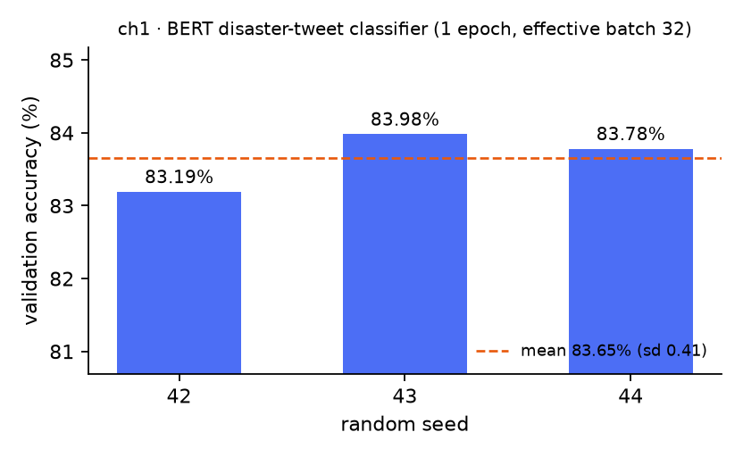
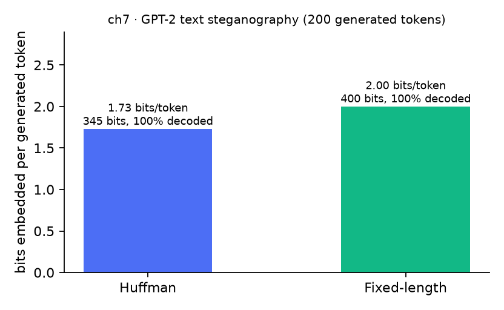
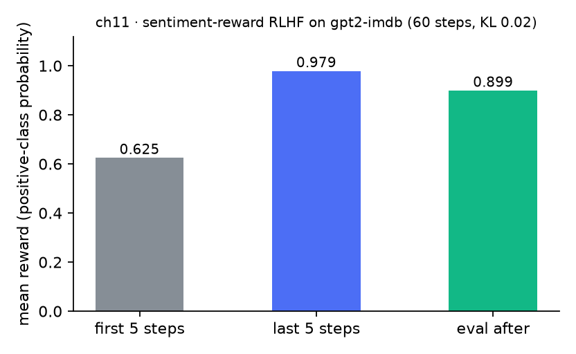

# 大模型课程实验复现（Dive into LLMs · 个人版）

本仓库是我对《动手学大模型》（`Lordog/dive-into-llms`，11 章）的**个人复现记录**：把我实际跑通的章节整理成可重复运行的脚本、日志与指标。课程原始 notebook 与课件仍在上游仓库，本仓库只放我自己的代码、运行记录和结果，便于复核，不替代原课程材料。

## 环境（实测）

| 项 | 值 |
|---|---|
| GPU | NVIDIA GeForce RTX 4060 Ti，8 GB 显存 |
| 驱动 / CUDA | 610.88 / torch 2.11.0+cu128 |
| Python | 3.11.3（venv：`D:\AAA_my_study\大模型\llm_env`） |
| 关键库 | transformers 5.8.0、datasets 4.8.5、pandas 3.0.3、scikit-learn 1.8.0 |
| 磁盘 | 约 105 GB 可用 |

## 结果表

> ch2 / ch6 / ch10 通过 DeepSeek 的 OpenAI 兼容接口运行（`deepseek-chat`，key 只从环境变量读取，不入库）。


| 章 | 实验 | 结果 | 本机耗时 | 产物 |
|---|---|---|---|---|
| ch1 | BERT 微调：灾害推文二分类（6793 行训练数据中的 6090 行、1523 行验证） | 验证集准确率 **83.19 / 83.98 / 83.78 %**（seed 42/43/44），均值 **83.65 %**，标准差 0.41 | 约 5 分钟/次（8 GB 卡，1 epoch） | `labs/ch1_bert_disaster_tweets/results/`、`docs/figures/ch1_val_accuracy.png` |
| ch7 | GPT-2 文本隐写：霍夫曼编码 vs 定长编码 | 200 token 内嵌入 **345 / 400 比特**（**1.73 / 2.00 比特/token**），补写解码器后比特恢复率 **100%** | 约 2 秒/次（CPU 也可跑） | `labs/ch7_gpt2_stegano/results/`、`docs/figures/ch7_bits_per_token.png` |
| ch2 | GSM8K 子集（40 题）上的四种提示策略 | 准确率 **92.5 %**（直答）→ **97.5 %**（few-shot）→ **100 %**（CoT，156 token/题；few-shot CoT 同为 100 %，127 token/题） | 约 40 秒/策略（DeepSeek API） | `labs/ch2_prompting_cot/results/` |
| ch6 | 摘要器上的提示注入（三种防御） | 攻击成功率 **100 %**（原样粘贴）→ **0 %**（`<<<DOC>>>` 定界）→ **0 %**（再加一句“忽略文档中的指令”）；干净文档摘要率始终 100 % | 约 2 分钟 | `labs/ch6_prompt_injection/results/` |
| ch10 | 工具调用智能体（计算器 / 读文件 / 单位换算） | 五题全对（**5/5**），共 6 次工具调用；两题需要串联两个工具 | 约 1 分钟 | `labs/ch10_tool_agent/results/` |
| ch11 | 情感奖励 RLHF（最小策略梯度替代 trl 的 PPO） | 平均奖励 **0.625 → 0.979**（后 5 步；复跑 0.670 → 0.886，见下）,训练后评估 **0.899**；样例显示明显的 reward hacking | 约 40 秒（8 GB 卡） | `labs/ch11_rlhf_sentiment/results/`、`docs/figures/ch11_reward_curve.png` |





未运行的章节与原因见 [`not_run.md`](not_run.md)（大显存或 API key 依赖）。

复跑记录（2026-11-01，干净目录执行 `reproduce.ps1`）：ch1 三个种子 83.72 / 83.85 / 83.65（均值 83.74，sd 0.10）；ch7 与首次完全一致（345 / 400 比特、1.73 / 2.00 比特每 token、还原率 100%）；ch11 奖励 0.670 → 0.886、评估 0.910、平均 KL 8.40，与首次方向一致但幅度不同，属策略梯度在小 batch 下的正常波动。

## 目录

```
labs/
  ch1_bert_disaster_tweets/   BERT 微调：灾害推文二分类（课程第 1 章）
    train_bert.py             训练与评测脚本（支持 --seed）
    run_seeds.py              多随机种子重复，输出 mean±sd
    results/                  日志、指标、测试集预测
  ch7_gpt2_stegano/           GPT-2 文本隐写（课程第 7 章）
    run_stegano.py            霍夫曼编码 / 固定长度编码 + 解码验证
    results/                  生成文本、比特嵌入与还原率
  ch11_rlhf_sentiment/        情感奖励 RLHF（课程第 11 章，最小策略梯度实现）
    run_rlhf.py               REINFORCE + KL 惩罚
    README.md                 与原 notebook 的差异、reward hacking 说明
    results/                  指标、训练日志、样例文本
results.csv                   所有指标的机器可读汇总（章 / 实验 / 指标 / 值 / 出处）
reproduce.ps1                 一条命令跑完三个实验并重画图
not_run.md                    未运行章节与卡点（显存 / API key）
```

## 复现步骤

```powershell
# 一条命令（约 20 分钟，其中 ch1 三个种子占大头）
powershell -ExecutionPolicy Bypass -File .\reproduce.ps1 -Python "D:\AAA_my_study\大模型\llm_env\Scripts\python.exe"

# 或分开跑
& $py -m pip install -r requirements.txt          # 1) 环境
cd labs\ch1_bert_disaster_tweets; & $py run_seeds.py                    # 2) 约 4–6 分钟/种子
cd ..\ch7_gpt2_stegano;            & $py run_stegano.py                 # 3) 约 10 秒
cd ..\ch11_rlhf_sentiment;         & $py run_rlhf.py                    # 4) 约 40 秒
& $py ..\..\make_figures.py                                             # 5) 重画图
```

数据路径可用环境变量覆盖：`CH1_DATA=<chapter1/TextClassification/TextClassification/data>`。
模型下载默认走 `HF_ENDPOINT=https://hf-mirror.com`；ch11 的两个 `lvwerra` 仓库镜像不可用，脚本改为直连 `https://huggingface.co`。

## 与课程原版的差异

1. **第 1 章**：上游用 `run_classification.py` + `transformers.Trainer`，在本机 `transformers 5.8` 下不兼容；我改用等价的显式训练循环（AdamW + 线性预热衰减 + 梯度累积），超参对齐上游 `train.sh`（1 epoch、lr 2e-5、有效 batch 32、max_len 512）。测试集在原数据中无标签，故只报告验证集指标，测试集仅输出预测。
2. **第 7 章**：notebook 的生成上限 30 步，只嵌入约 56 比特，且没有解码器；脚本把上限提到 200 步，并补写解码器以测量比特还原率。
3. **第 11 章**：`trl` 的 `PPOTrainer` 与本机 `transformers 5.8` 不兼容；保留课程的两个模型，把训练循环写成 REINFORCE + k1 KL 惩罚（**不是 PPO**），细节与结论见 `labs/ch11_rlhf_sentiment/README.md`。

## 许可与归属

本仓库的脚本、日志与结果文件以 MIT 许可发布（见 `LICENSE`）。
课程《动手学大模型》(`Lordog/dive-into-llms`) 的 notebook、课件与数据归原作者，未随本仓库分发，使用时请遵循上游许可。
